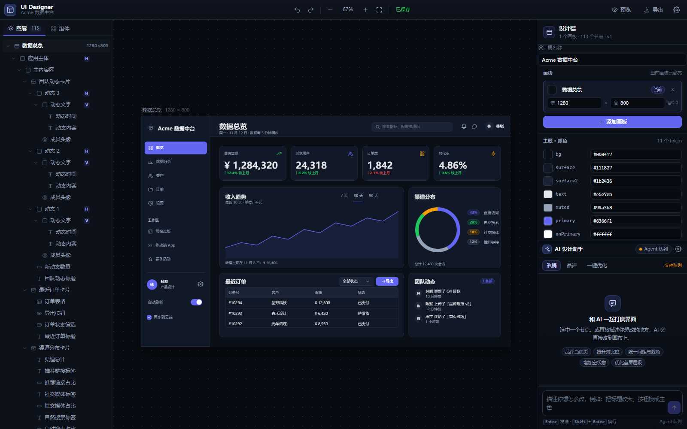

# UI Designer · AI-native UI design studio

> Design UI in the browser like Figma, refine it with natural language, then export it as
> HTML/CSS, React + Tailwind, or design tokens. The design document is a plain
> `design.json` that an AI coding agent can read and edit precisely.

**English** | [中文](README.md)

- 🎨 Visual editing: artboards, layer tree, drag/resize/snap, property inspector, 30 components, theme tokens
- 🤖 AI editing + critique: chat to change the UI, get findings with one-click fixes
- 🔌 Two AI channels: direct OpenAI-compatible model, **or no API key at all** (your coding agent processes requests from a file queue)
- 📄 The design is a file: diff-friendly, reviewable, agent-editable
- 📦 Export: standalone HTML/CSS, React + Tailwind TSX, tokens CSS
- 🧩 Zero dependencies: Node.js built-ins + native ES modules, no `npm install`, no build step



---

## Requirements

- **Node.js >= 20** (no npm install needed)
- A modern browser (Chrome / Edge / Safari / Firefox)
- Optional: DSH (DeepSeek Harness) to use it as a skill and let the agent handle AI requests
- Optional: any OpenAI-compatible model endpoint (without it, use the Agent queue channel)

## Install as a DSH skill

DSH scans skill directories (highest priority first):

| Priority | Directory | Scope |
|---|---|---|
| 1 | `<project>/.dsh/skills/` | project only |
| 2 | `<project>/.agents/skills/` | project only |
| 3 | `~/.dsh/skills/` (`DSH_HOME` overrides) | all projects |
| 4 | `~/.agents/skills/` | all projects |

The skill folder must contain `SKILL.md`, e.g. `~/.dsh/skills/ui-designer/SKILL.md`.

```bash
# macOS / Linux
mkdir -p ~/.dsh/skills
git clone https://github.com/freeheart/ui-designer.git ~/.dsh/skills/ui-designer
```

```powershell
# Windows PowerShell
New-Item -ItemType Directory -Force "$env:USERPROFILE\.dsh\skills" | Out-Null
git clone https://github.com/freeheart/ui-designer.git "$env:USERPROFILE\.dsh\skills\ui-designer"
```

Verify: start a new DSH session and ask the agent to *list available skills*; `ui-designer`
should appear. Then say **“use ui-designer to design a wallet home screen”** or invoke it
explicitly with `$ui-designer`.

## Try it in 60 seconds (no DSH required)

```bash
cd <skill-dir>
node scripts/demo.mjs
```

This creates `./ui-designer-demo/design.json` from the bundled example and opens
`http://127.0.0.1:4173/`. Try: click an element → edit properties on the right; switch the
left tab to **components** and insert a block; ask the AI panel to restyle something;
switch to **critique** mode; press `P` for preview; click **Export** to generate
React + Tailwind code.

`demo.mjs` options: `--port 4300`, `--dir <dir>`, `--no-open`, `--force`.

## Using it without DSH (Cursor / Claude Code / any agent)

The whole tool is a local Node server + CLI; any coding agent that can run terminal
commands can use it. Point the agent at `SKILL.md` (or add a short rule / `AGENTS.md`
entry) and it can:

```bash
node scripts/init.mjs --dir designs/home --name "Wallet"
node scripts/ops.mjs --design designs/home/design.json --ops ops.json   # edit via ops
node scripts/server.mjs --design designs/home/design.json --port 4173 --open
node scripts/export.mjs --design designs/home/design.json --format all --out src/design-export
```

## AI: two channels

### A. Direct model (OpenAI-compatible)

Click the gear in the AI panel and fill in Base URL (must include `/v1`), model name and
API key. The key is stored in `~/.dsh/ui-designer.json`, never in your project.

| Provider | Base URL | Model example |
|---|---|---|
| DeepSeek | `https://api.deepseek.com/v1` | `deepseek-chat` |
| OpenAI | `https://api.openai.com/v1` | `gpt-4o-mini` |
| Qwen (compatible mode) | `https://dashscope.aliyuncs.com/compatible-mode/v1` | `qwen-plus` |
| Moonshot | `https://api.moonshot.cn/v1` | `moonshot-v1-8k` |
| Ollama (local) | `http://127.0.0.1:11434/v1` | `qwen2.5:7b` |

Or configure via environment variables before starting the server:

```bash
UI_DESIGNER_BASE_URL=https://api.deepseek.com/v1 \
UI_DESIGNER_API_KEY=sk-... \
UI_DESIGNER_MODEL=deepseek-chat \
node scripts/server.mjs --design designs/home/design.json --port 4173 --open
```

### B. Agent queue (no API key needed)

Requests are written to `designs/<name>/.ai/inbox/` and answered by your coding agent:

```bash
node scripts/agent-bridge.mjs pending --design designs/home/design.json
node scripts/ops.mjs --design designs/home/design.json --compact
node scripts/agent-bridge.mjs reply --design designs/home/design.json \
  --id req-xxxxxxxx --message "Updated the primary button contrast" --ops ops.json
```

For critique requests, reply with `--findings findings.json` (no design changes).
`agent-bridge.mjs watch` keeps listening for new requests (JSON Lines on stdout).

## Export

```bash
node scripts/export.mjs --design designs/home/design.json --format all --out src/design-export
```

| Format | Output | Use |
|---|---|---|
| `html` | `index.html` (single file, inline CSS) | quick preview / static prototype |
| `react` | `FMain.tsx` (React + Tailwind) | paste into a React project |
| `tokens` | `tokens.css` (`:root` variables) | global design tokens |
| `all` | all of the above | default |

The exported React component is an absolutely-positioned high-fidelity rendition using
Tailwind arbitrary values + CSS variables; add interactions (hover/loading/empty states)
in your codebase. Multiple states? Add multiple artboards in the design.

## CLI cheat sheet

| Command | Purpose |
|---|---|
| `node scripts/demo.mjs` | zero-setup demo |
| `node scripts/init.mjs --dir <dir> --name <name>` | scaffold a design document |
| `node scripts/server.mjs --design <design.json> [--port 4173] [--open]` | start the designer |
| `node scripts/ops.mjs --design <d> --ops <ops.json>` | apply ops atomically |
| `node scripts/ops.mjs --design <d> --validate` / `--compact` / `--summary` | validate / compact tree / heuristic warnings |
| `node scripts/agent-bridge.mjs pending\|reply\|watch` | AI request queue for coding agents |
| `node scripts/export.mjs --format html\|react\|tokens\|all` | export code |

## Design document in one minute

`design.json` = `version`, `name`, `theme` (tokens), `frames` (artboards), `rootIds`, and a
flat `nodes` map with a `children` tree. Node types: `box text button input image icon
divider badge avatar toggle checkbox select tabs table chart card`. Layout modes:
`absolute` (x/y) or `row`/`column` with gap/padding/align/justify. Colors/radii/font sizes
accept token names (`primary`, `md`) or literals (`#6366f1`, `8`).

See [references/design-spec.md](references/design-spec.md) and
[references/ops-protocol.md](references/ops-protocol.md) for the complete schema and ops.

## Security & privacy

- The server binds to `127.0.0.1` only; no accounts, no telemetry, no uploads.
- API keys live in `~/.dsh/ui-designer.json` or environment variables — never in the project.
- `designs/<name>/.ai/` is git-ignored, so the agent queue stays out of your repository.
- The only outbound traffic is to the model `baseUrl` you configure (Agent-queue mode is fully offline).

## FAQ (short)

- **Port busy?** use `--port 4300`, or stop the old process.
- **AI always uses Agent queue?** configure a key + model (or set `UI_DESIGNER_MODE=api`) and restart.
- **AI reply “cannot parse”?** the server retries once with the error fed back; switch to a model
  that follows JSON instructions (e.g. `deepseek-chat`, `gpt-4o-mini`).
- **Undo doesn’t cover agent edits?** agent writes appear via live reload and are not part of the
  browser undo stack; editor actions are.
- **Responsive design?** create multiple artboards (390 / 768 / 1280) and implement breakpoints in code.
- **Images?** `image` nodes accept `props.src`; otherwise a checkerboard placeholder is shown.

## Known limitations

Static high-fidelity mockups (no interaction logic); single-user, local only; no multi-select
group resize yet; artboards are positioned via the inspector, not dragged; the agent-queue
reply bubble is only streamed while the page is open (the design file still updates).

## License

MIT License © 2026 Jinzhu.Zhang. See [LICENSE](LICENSE).
