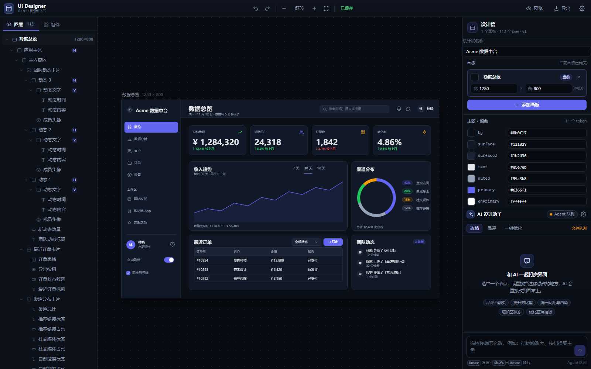
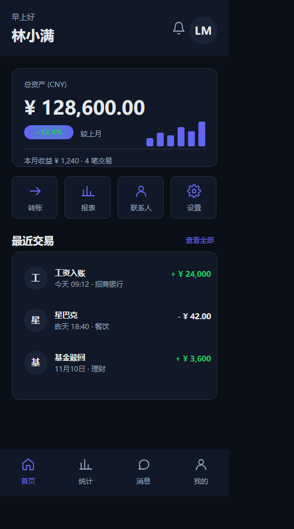
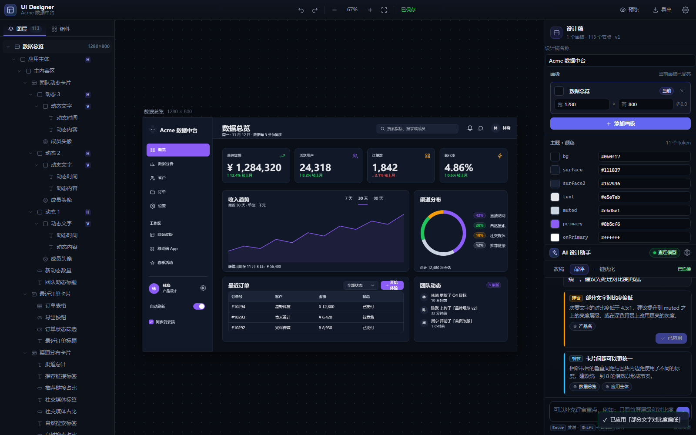
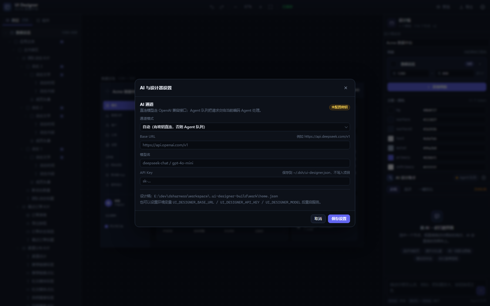
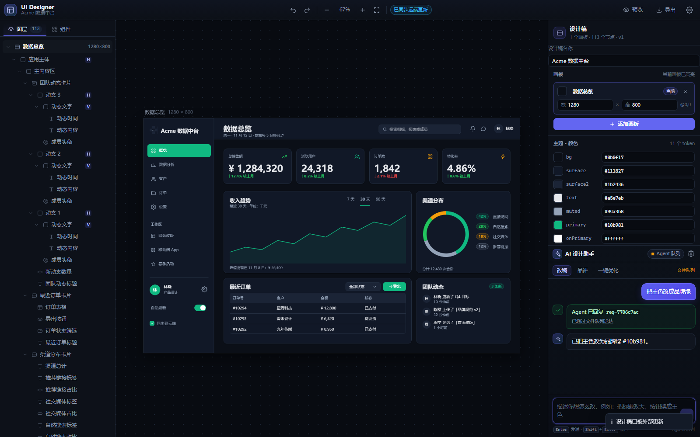
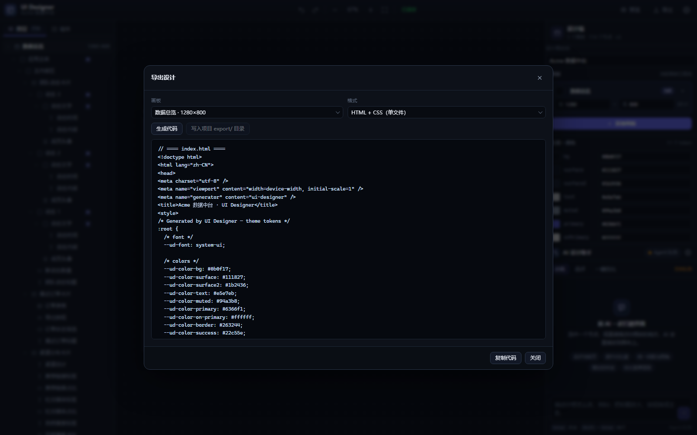

# UI Designer · AI 原生 UI 设计器

> 在浏览器里像 Figma 一样拖拽界面，用一句话让 AI 改稿/品评，最后把设计稿直接导出成
> HTML/CSS、React + Tailwind 或设计令牌。设计稿是一份可被 AI Agent 读写的 `design.json`。


🔗 [github.com/freeheart/ui-designer](https://github.com/freeheart/ui-designer) · MIT © 2026 Jinzhu.Zhang

[](docs/screenshots/editor.png)

**中文** | [English](README.en.md)

- 🎨 **可视化设计**：画板、图层树、拖拽/缩放/吸附、属性检查器、30 个组件、主题令牌
- 🤖 **AI 改稿 + 品评**：对话式修改，品评给出可一键应用的优化建议
- 🔌 **双 AI 通道**：直连 OpenAI 兼容模型，**没有 API Key 也能用**（交给 Cursor/DSH 等编码 Agent 处理）
- 📄 **设计稿即文件**：`design.json` 可 diff、可 review、可被 Agent 精确修改
- 📦 **一键导出**：单文件 HTML/CSS、React + Tailwind、设计令牌 CSS
- 🧩 **零依赖**：只用 Node.js 内置模块 + 原生 ES Module，`npm install` 都不需要

适合：想“先定 UI 再写代码”的开发者、用 Cursor/DSH/Claude Code 做前端的人、需要让 AI
参与界面评审的小团队。  
不适合：需要多人实时协作、完整设计系统管理、原型交互逻辑的重量级设计团队（这时请用 Figma）。

---

## 最短路径（懒人版）

```powershell
# 1) 安装（Windows；macOS/Linux 见第 4 节）
git clone https://github.com/freeheart/ui-designer.git "$env:USERPROFILE\.dsh\skills\ui-designer"

# 2) 先跑一个现成示例（不装 DSH 也能跑）
node "$env:USERPROFILE\.dsh\skills\ui-designer\scripts\demo.mjs"
```

3) 在 DSH（或 Cursor 等）里说：**「用 ui-designer 设计一个记账 App 首页，390×844，深色主题」**。
剩下的交给 Agent，它会按 `SKILL.md` 里的工作流初始化设计稿、启动设计器并让你审阅。

> 只想先看看效果？方式 2 就够了；只想要 AI 对话？配一个模型 Key 或让 Agent 处理队列（第 8 节）。
> 本仓库在 Windows 11 / Node 24 / Chrome / DSH 桌面版上完整验证过。

---

## 目录

1. [这是什么](#1-这是什么)
2. [功能一览](#2-功能一览)
3. [环境要求](#3-环境要求)
4. [安装](#4-安装)
5. [60 秒上手](#5-60-秒上手)
6. [界面导览](#6-界面导览)
7. [画布操作](#7-画布操作)
8. [用 AI 改稿与品评](#8-用-ai-改稿与品评)
9. [从需求到代码：完整工作流](#9-从需求到代码完整工作流)
10. [导出与接入代码库](#10-导出与接入代码库)
11. [命令行速查](#11-命令行速查)
12. [快捷键](#12-快捷键)
13. [design.json 速览](#13-designjson-速览)
14. [架构与安全](#14-架构与安全)
15. [常见问题 FAQ](#15-常见问题-faq)
16. [目录结构](#16-目录结构)
17. [已知限制与路线图](#17-已知限制与路线图)
18. [贡献](#18-贡献)
19. [发布到 GitHub 的检查清单](#19-发布到-github-的检查清单)
20. [License](#20-license)
21. [更新日志](#21-更新日志)

---

## 1. 这是什么

一句话：**把「设计稿 + 可视化编辑器 + AI 设计助手」装进你的项目目录。**

```
designs/home/design.json      ← 唯一事实来源（设计稿就是你项目里的一个文件）
        │
        ├─ 本地服务 server.mjs（127.0.0.1:4173）
        │     ├─→ 浏览器编辑器：画布 / 图层 / 属性 / 组件库 / AI 面板
        │     └─→ AI 双通道：① 直连模型  ② Agent 文件队列（交给编码 Agent）
        │
        └─→ 导出：index.html · FHome.tsx · tokens.css
```

和 Figma 等在线工具的关键差别：

| | UI Designer | Figma |
|---|---|---|
| 设计稿格式 | 项目内的 `design.json`（git diff、可被 AI 精确改） | 私有格式，存在云端 |
| AI 改稿 | 内置，返回**结构化 ops**，不会“重画整页” | 插件/外部工具，难落地到代码 |
| 交付方式 | 直接导出 HTML / React+Tailwind / tokens | 需插件或手动还原 |
| 运行方式 | 本地 `node` 一条命令，数据不出本机 | SaaS |
| 协作 | 单人 + AI | 多人实时协作 |

`SKILL.md` 是给 AI Agent 的使用指令；**本 README 是给人看的**。

---

## 2. 功能一览

| 模块 | 能力 |
|---|---|
| 画布 | 多画板、拖拽移动、8 手柄缩放、吸附参考线、缩放/平移、框选清除、预览模式 |
| 图层 | 树形层级、展开/折叠、显隐、锁定、Shift 多选、自动布局 H/V 角标 |
| 属性 | X/Y/宽/高、自由/横排/竖排布局 + gap/padding/align/justify、填充、描边、圆角、阴影、透明度、字体、内容 |
| 组件库 | 16 个基础元素 + 14 个组合区块（导航栏/Hero/指标行/卡片网格/表单/侧边栏/表格页/设置列表/弹窗/空状态/定价/聊天列表…） |
| 主题 | 全局颜色/圆角/间距/字号/字体/阴影令牌，改一处全站生效 |
| AI 对话 | 改稿 / 品评（findings 卡片 + 一键应用）/ 一键优化 三种模式 |
| AI 通道 | A. 直连 OpenAI 兼容模型；B. 无 Key 时写入 `.ai/inbox` 由编码 Agent 处理 |
| 预览 | `P` 进入全屏预览，隐藏编辑器 chrome |
| 导出 | 单文件 HTML+CSS、React+Tailwind TSX、设计令牌 CSS；CLI 或界面 |
| Agent CLI | `init` / `ops`（validate/compact/summary）/ `agent-bridge`（pending/reply/watch）/ `export` |
| 实时同步 | 浏览器、CLI、Agent 三方改同一个 `design.json`，服务端校验 + SSE 热更新 |

截图总览：[画布](docs/screenshots/editor.png) ·
[属性面板](docs/screenshots/inspector.png) ·
[组件库](docs/screenshots/components.png) ·
[AI 品评](docs/screenshots/chat-critique.png) ·
[Agent 队列](docs/screenshots/agent-queue.png) ·
[导出](docs/screenshots/export.png) ·
[预览](docs/screenshots/preview.png) ·
[设置](docs/screenshots/settings.png) ·
[导出效果示例](docs/screenshots/example-design.png)

---

## 3. 环境要求

| 依赖 | 要求 | 说明 |
|---|---|---|
| Node.js | **>= 20** | 只用内置模块，**不需要** `npm install` |
| 浏览器 | Chrome / Edge / Safari / Firefox 最近版本 | 建议用 Chrome/Edge |
| DSH（可选） | 支持 skills 的 DeepSeek Harness | 装成技能后可用自然语言触发、用 Agent 队列 |
| 模型 API（可选） | 任意 OpenAI 兼容接口 | 没有 Key 也能用「Agent 队列」模式 |

> 没有 DSH 也能用：本项目本身就是一套本地工具，`node scripts/demo.mjs` 即可打开。
> DSH 只负责“让 AI Agent 知道怎么用它、并替你处理 AI 请求”。

---

## 4. 安装

### 4.1 装成 DSH 技能（推荐）

DSH 会自动扫描以下技能目录（按优先级）：

| 优先级 | 目录 | 适用 |
|---|---|---|
| 1 | `<项目根>/.dsh/skills/` | 只在这个项目里用 |
| 2 | `<项目根>/.agents/skills/` | 只在这个项目里用 |
| 3 | `~/.dsh/skills/`（`DSH_HOME` 可覆盖） | 所有项目可用 |
| 4 | `~/.agents/skills/` | 所有项目可用 |

技能目录必须满足：**`ui-designer/SKILL.md`** 存在（文件夹名建议保持 `ui-designer`）。

**方式 A：git clone（推荐，方便 `git pull` 更新）**

```powershell
# Windows PowerShell
New-Item -ItemType Directory -Force "$env:USERPROFILE\.dsh\skills" | Out-Null
git clone https://github.com/freeheart/ui-designer.git "$env:USERPROFILE\.dsh\skills\ui-designer"
```

```bash
# macOS / Linux
mkdir -p ~/.dsh/skills
git clone https://github.com/freeheart/ui-designer.git ~/.dsh/skills/ui-designer
```

**方式 B：下载 ZIP**  
下载仓库 ZIP → 解压 → 把里面的文件夹重命名为 `ui-designer` → 放到 `~/.dsh/skills/` 下，
最终路径是 `~/.dsh/skills/ui-designer/SKILL.md`。

**方式 C：项目级安装**（团队共享、跟仓库一起提交）

```powershell
# 在项目根目录执行（项目需有 .git 或在此目录打开会话）
New-Item -ItemType Directory -Force .dsh\skills | Out-Null
Copy-Item -Recurse -Force "C:\path\to\ui-designer" ".dsh\skills\ui-designer"
```

**方式 D：自定义目录**  
在 DSH 配置中把 `customSkillDirs` 指向仓库父目录（详见 DSH 技能配置文档）。

**验证是否装好**

1. 新开一个 DSH 会话（技能目录会重新扫描）；
2. 对 Agent 说：**「列出你当前可用的技能」**，应能看到 `ui-designer`；
3. 或直接说：**「用 ui-designer 给记账 App 设计一个首页」**；
4. 也可显式调用：输入 `$ui-designer` 触发技能。

### 4.2 不装 DSH，直接当本地工具用

```powershell
cd <技能目录>
node scripts/demo.mjs          # 自动准备示例设计稿并打开浏览器
```

### 4.3 更新

- git 安装：`cd ~/.dsh/skills/ui-designer && git pull`
- ZIP 安装：用新版覆盖该目录
- 更新后重开 DSH 会话（或新会话）让技能目录刷新。

### 4.4 在 Cursor / Claude Code / Codex CLI 里使用（不装 DSH）

本技能不绑定 DSH，只要有 Node 就能用；Agent 只是通过终端命令来操作它：

1. 把仓库放到项目里（例如 `tools/ui-designer`）或用户目录 `~/.dsh/skills/ui-designer`；
2. 在项目的 `AGENTS.md`（Cursor 也可以用 `.cursor/rules/*.mdc`）里加一条指引，例如：

```markdown
当用户要做界面设计、改版、UI 评审，或把设计稿转成前端代码时：
1. 先读 `tools/ui-designer/SKILL.md`（或 ~/.dsh/skills/ui-designer/SKILL.md）；
2. 按其中“工作流 A/B/C/D”执行；
3. 设计器的 AI 请求用 `node tools/ui-designer/scripts/agent-bridge.mjs pending|reply --design <design.json>` 处理。
```

3. 之后直接对 Cursor 说「设计一个登录页」，Agent 会读 SKILL.md 并跑
   `init.mjs` / `ops.mjs` / `server.mjs`；AI 面板里的请求由它通过 `agent-bridge.mjs` 回复。

> 提示：把技能放在项目里（`tools/ui-designer`）更适合团队协作和版本固定；放在
> `~/.dsh/skills/` 则所有项目可用。两种方式可以同时存在。

---

## 5. 60 秒上手

```powershell
cd ~/.dsh/skills/ui-designer      # 或任意存放本仓库的目录
node scripts/demo.mjs             # 自动创建 ./ui-designer-demo/design.json 并打开浏览器
```

浏览器会打开 `http://127.0.0.1:4173/`，你会看到一个 54 节点的「钱包首页」示例：



试试这些操作：

1. 点击画布上的任意元素 → 右侧出现属性面板，改 X/宽/填充色，画布实时变化；
2. 左侧切到 **组件** → 点「指标行」插入到选中容器；
3. 右侧 AI 面板输入「让主色更有质感，统一卡片圆角」→ 点发送；
4. 点 AI 面板的 **品评** → 输入「品评这个页面」→ 看 findings 卡片 → 点「应用建议」；
5. 按 `P` 进入预览；按 `Esc` 退出；
6. 点右上角 **导出** → 选「React + Tailwind」→ 生成代码并复制。

关闭：`Ctrl+C` 停止服务；设计稿保存在 `./ui-designer-demo/design.json`，可以随时再打开。

> `demo.mjs` 参数：`--port 4300`、`--dir <目录>`、`--no-open`、`--force`（覆盖示例稿）。

---

## 6. 界面导览


| 区域 | 说明 |
|---|---|
| 顶部工具栏 | 设计稿名称（双击重命名）、撤销/重做、缩放、适应画布、保存状态、预览、导出、AI 设置 |
| 左栏「图层」 | 画板与节点树；眼睛=显隐，锁=锁定；点击选中，`Shift` 多选 |
| 左栏「组件」 | 基础元素 + 组合区块，点击插入到当前选中容器（无选中则插入画板根） |
| 中间画布 | 多个画板横向排列；拖拽/缩放/吸附；空白处点击取消选中 |
| 右栏上半「属性」 | 未选中=文档与主题令牌；选中节点=布局/样式/文字/内容/操作；选中画板=画板尺寸与背景 |
| 右栏下半「AI 助手」 | 渠道状态、模式（改稿/品评/一键优化）、对话记录、输入框、快捷提示词 |
| 右上角齿轮 | AI 通道设置（直连模型地址/模型名/API Key） |

---

## 7. 画布操作

### 鼠标

| 操作 | 效果 |
|---|---|
| 单击元素 | 选中（右侧显示属性） |
| 拖拽元素 | 移动，靠近父容器/兄弟元素边缘或中线时自动吸附并显示参考线 |
| 拖拽选中框 8 个手柄 | 调整宽高 |
| 单击空白/画板背景 | 取消选中 / 选中画板 |
| 滚轮 | 上/下平移 |
| `空格` + 拖拽 / 中键拖拽 | 平移画布 |
| `Ctrl/Cmd` + 滚轮 | 以光标为中心缩放（25%–300%） |
| 点击工具栏百分比 | 重置为 100% |

### 键盘

见 [快捷键](#12-快捷键)。

### 图层与组件

- 图层行右侧的眼睛/锁可切换显隐和锁定；锁定的节点不能拖动但可选中。
- 自动布局容器（横排/竖排）的节点行会显示 `H` / `V` 角标；容器内新增子元素会自动排布。
- 组件库 30 项：
  - 基础：容器、文本、按钮、输入框、图片、图标、分割线、徽标、头像、开关、复选框、下拉框、标签页、表格、图表、卡片
  - 区块：导航栏、Hero 首屏、数据指标、卡片网格、表单、侧边栏布局、表格页、设置列表、对话框、提示条、空状态、消息列表、定价、页脚
- 插入的区块会自动适配当前画板宽度（移动端 390 宽时内容宽 358）。

### 属性面板

- **布局**：X/Y/宽/高、布局模式（自由/横排/竖排）、gap、内边距、交叉轴 align、主轴 justify
- **样式**：填充（token 或 #hex）、圆角、不透明度、描边（颜色/宽度）、阴影
- **文字**：字号、字重、颜色、对齐、行高、字距（文本/按钮等文本类节点）
- **内容**：文本内容、按钮文案/图标、输入框占位符、表格列与行、图表类型与数据、标签页、开关状态…
- **操作**：重命名、复制、上移、下移、显隐、锁定、删除

### 主题令牌

未选中任何节点时，右侧是**文档与主题**编辑：

- 设计稿名称、画板列表（名称/尺寸/背景，可增删）
- 颜色令牌（11 个默认：`bg`/`surface`/`surface2`/`text`/`muted`/`primary`/`onPrimary`/`border`/`success`/`warning`/`danger`）
- 圆角/间距/字号/字体/阴影令牌

改 `colors.primary` 等令牌会**同时**影响画布和导出代码（导出使用 CSS 变量）。

---

## 8. 用 AI 改稿与品评

右侧 AI 面板有三种模式：

| 模式 | 行为 | 适用 |
|---|---|---|
| **改稿** | 直接修改设计稿，改动会实时出现在画布 | “把标题改大”“换成卡片布局” |
| **品评** | 只给 3–6 条问题与优化建议，每条可「应用建议」 | “评审这个页面” |
| **一键优化** | 不改变信息结构，做一轮系统优化 | “统一间距/提升对比度/优化首屏层级” |



### 8.1 方式 A：直连模型（推荐，体验最顺）

右上角齿轮 → 填写：



| 字段 | 说明 |
|---|---|
| 通道模式 | `自动`（有 Key 直连，否则 Agent 队列）/ `直连模型 API` / `Agent 文件队列` |
| Base URL | OpenAI 兼容地址，**要带 `/v1`**（服务端会拼 `/chat/completions`） |
| 模型名 | 例如 `deepseek-chat`、`gpt-4o-mini` |
| API Key | 只保存在 `~/.dsh/ui-designer.json`，**不写入项目** |

常见服务商示例（以官方文档为准）：

| 服务商 | Base URL | 模型示例 |
|---|---|---|
| DeepSeek | `https://api.deepseek.com/v1` | `deepseek-chat` |
| OpenAI | `https://api.openai.com/v1` | `gpt-4o-mini` |
| 通义千问（兼容模式） | `https://dashscope.aliyuncs.com/compatible-mode/v1` | `qwen-plus` |
| Moonshot | `https://api.moonshot.cn/v1` | `moonshot-v1-8k` |
| 智谱 | `https://open.bigmodel.cn/api/paas/v4` | `glm-4-flash` |
| 本地 Ollama | `http://127.0.0.1:11434/v1` | `qwen2.5:7b`（Key 随便填） |

也可以用环境变量启动服务（优先级最高）：

```powershell
$env:UI_DESIGNER_BASE_URL = 'https://api.deepseek.com/v1'
$env:UI_DESIGNER_API_KEY  = 'sk-...'
$env:UI_DESIGNER_MODEL    = 'deepseek-chat'
node scripts/server.mjs --design designs/home/design.json --port 4173 --open
```

支持的变量：`UI_DESIGNER_BASE_URL`、`UI_DESIGNER_API_KEY`、`UI_DESIGNER_MODEL`、
`UI_DESIGNER_MODE`（`auto|api|agent`）。配置文件优先级：
环境变量 > `designs/<name>/designer.config.json` > `<项目>/.dsh/ui-designer.json` > `~/.dsh/ui-designer.json`。

### 8.2 方式 B：Agent 文件队列（没有 API Key 也能用）

AI 面板发出请求后，服务端把请求写到 `designs/<name>/.ai/inbox/`，由**你的编码 Agent**
（Cursor / DSH / Claude Code / 任意能跑 Node 的 Agent）处理：

```powershell
$d = "designs/home/design.json"

# 1) 看有没有待处理请求（JSON 数组）
node scripts/agent-bridge.mjs pending --design $d

# 2) 看当前设计稿（紧凑树，省 token）
node scripts/ops.mjs --design $d --compact

# 3) 写一个 ops 文件（怎么改），然后回复；reply 会先应用 ops 并写回 design.json
node scripts/agent-bridge.mjs reply --design $d --id req-1a2b3c4d `
  --message "已把主按钮对比度提高到 7.2:1" --ops ops.json
```

品评请求用 findings 回复（不修改设计稿）：

```powershell
node scripts/agent-bridge.mjs reply --design $d --id req-1a2b3c4d `
  --message "共 3 条建议" --findings findings.json
```



在 DSH/Cursor 里可以直接对 Agent 说：

> 设计器里有待处理的 AI 请求，用 `scripts/agent-bridge.mjs pending` 看一下并处理掉。

`watch` 模式可让 Agent 持续监听新请求：

```powershell
node scripts/agent-bridge.mjs watch --design $d --once    # 只处理当前一批
node scripts/agent-bridge.mjs watch --design $d           # 持续监听（JSON Lines 输出）
```

队列文件说明：`.ai/inbox/<requestId>.json` 是请求，`.ai/outbox/<requestId>.json` 是回复；
`.ai/.gitignore` 已自动忽略这两个目录，不会污染仓库。

### 8.3 提示词示例（直接复制）

```
把页面标题字重改到 700、字号提到 24，并和副标题左对齐。
主按钮改成 primary 填充、白色文字、圆角 12，高度 44。
三张指标卡改成横排、间距 16、卡片内边距 20，数值字号统一 28。
品评这个页面，重点关注信息层级、间距节奏和对比度，最多 5 条。
一键优化：统一 8pt 间距、统一圆角、提升次要文字对比度，不要改变信息结构。
把「最近订单」表格换成空状态（暂无数据 + 新建订单按钮）。
```

### 8.4 AI 相关排错

| 现象 | 原因 / 处理 |
|---|---|
| `401 Unauthorized` | API Key 错误或过期；重新在设置里填写 |
| `404` | Base URL 少了 `/v1`，或模型名不对 |
| 超时 | 换更快模型/本地模型，或设置环境变量 `UI_DESIGNER_MODE=agent` 改用队列 |
| 回复“无法解析” | 模型没按 JSON 输出；服务端会自动带错误重试一次，仍失败可换模型（推荐 deepseek-chat / gpt-4o-mini 等指令遵循较好的） |
| 品评/改稿没反应 | 检查 AI 面板右上角渠道徽章：`直连模型` 还是 `Agent 队列`；队列模式需要有 Agent 去处理 |

---

## 9. 从需求到代码：完整工作流

以下以「用 Cursor/DSH 开发一个记账 App」为例。你可以把整段贴给 Agent：

> 用 `ui-designer` 技能，在 `designs/wallet/` 新建一个 390×844 的移动端首页：
> 顶部余额卡（金额 + 本月收支）、快捷操作 4 个、最近交易列表、底部导航。
> 完成后启动设计器让我看，并按 8pt 网格和深色主题检查一遍。

Agent 实际会做的步骤（这些命令你也可以手动执行）：

```powershell
# 1) 生成设计稿骨架
node scripts/init.mjs --dir designs/wallet --name "记账 App" --width 390 --height 844

# 2) 写 ops（一次可加整棵子树），例如 ops.json：
#    [{ "op": "add", "parent": "f-main", "node": { "type": "text", ... } }]
node scripts/ops.mjs --design designs/wallet/design.json --ops ops.json

# 3) 每批改动后校验 + 自检
node scripts/ops.mjs --design designs/wallet/design.json --validate
node scripts/ops.mjs --design designs/wallet/design.json --summary
#    summary 会给出越界、对比度 < 4.5:1、点击区域过小等警告

# 4) 启动设计器让用户审阅
node scripts/server.mjs --design designs/wallet/design.json --port 4173 --open
```

然后进入迭代循环：

1. 用户在画布里手动微调（自动保存）；
2. 用户在 AI 面板里说需求 → 直连模型直接改 / Agent 队列由你改；
3. 用户说「品评一下」→ AI 返回 findings → 一键应用；
4. 你认为布局有问题时，用 `ops.mjs --compact` 看现状，再写一批 ops 增量修改；
5. 定稿后导出（下一节）。

一个最小 ops 示例（在画板根节点追加一个文本节点）：

```json
[
  {
    "op": "add",
    "parent": "f-main",
    "node": {
      "type": "text",
      "name": "页面标题",
      "x": 16, "y": 24, "w": 280, "h": 32,
      "props": { "text": "我的账本" },
      "style": { "font": { "size": "xl", "weight": 700, "color": "text" } }
    }
  }
]
```

完整 ops 语法见 [references/ops-protocol.md](references/ops-protocol.md)，
设计稿 schema 见 [references/design-spec.md](references/design-spec.md)。

---

## 10. 导出与接入代码库



两种方式等价：

```powershell
node scripts/export.mjs --design designs/wallet/design.json --format all --out src/design-export
```

或在设计器里点 **导出** → 选画板与格式 → 生成代码 / 复制 / 写入 `designs/<name>/export/`。

| 格式 | 产物 | 用途 |
|---|---|---|
| `html` | `index.html`（单文件，内联 CSS） | 快速预览、静态原型、发给别人看 |
| `react` | `FMain.tsx`（React + Tailwind） | 粘贴进 React 项目继续开发 |
| `tokens` | `tokens.css`（`:root` CSS 变量） | 并入项目全局样式，统一设计令牌 |
| `all` | 上面三个文件 | 默认 |

**接入 React 项目：**

1. 把 `tokens.css` 引入全局（如 `src/styles/tokens.css`，在 `main.tsx` import）；
2. 把 `FMain.tsx` 放到 `src/components/`，按项目规范拆组件、替换占位图片、接真实数据；
3. 导出的组件是**绝对定位的高保真静态还原**（Tailwind arbitrary values + CSS 变量），
   适合当你写代码的视觉基准；交互（hover/loading/空态/路由）在代码里补；
4. 需要多状态（默认/空/加载/错误）时，在设计稿里加多个画板分别表达，再分别导出。

> React 导出默认 `import './tokens.css'`，单独复制 TSX 时记得同时带上 tokens.css（文件头注释有说明）。

---

## 11. 命令行速查

| 命令 | 作用 |
|---|---|
| `node scripts/demo.mjs` | 零配置演示：生成示例设计稿并启动设计器 |
| `node scripts/init.mjs --dir <dir> --name <名字> [--width 390 --height 844] [--frame-name 首页] [--from <design.json>] [--force]` | 新建设计稿（可选从示例/已有稿复制） |
| `node scripts/server.mjs --design <design.json> [--port 4173] [--host 127.0.0.1] [--open]` | 启动设计器（设计稿不存在会自动创建空稿） |
| `node scripts/ops.mjs --design <d> --ops <ops.json\|-> [--dry-run] [--stdout] [--out <path>]` | 原子应用 ops |
| `node scripts/ops.mjs --design <d> --validate` | 校验设计稿 schema |
| `node scripts/ops.mjs --design <d> --compact` | 打印紧凑设计稿树（给模型/自己看） |
| `node scripts/ops.mjs --design <d> --summary` | 统计 + 越界/对比度/点击区域警告 |
| `node scripts/agent-bridge.mjs pending --design <d>` | 列出待处理的 AI 请求 |
| `node scripts/agent-bridge.mjs reply --design <d> --id <id> --message "..." [--ops ops.json] [--findings findings.json] [--dry-run]` | 回复 AI 请求（可同时应用 ops） |
| `node scripts/agent-bridge.mjs watch --design <d> [--once] [--interval 1000]` | 持续监听新请求（JSON Lines） |
| `node scripts/export.mjs --design <d> --format html\|react\|tokens\|all [--frame <id\|all>] [--out <dir>] [--stdout]` | 导出代码 |

退出码：成功 `0`；参数/校验/ops 失败 `1`（错误信息在 stdout/stderr 的 JSON 里）。

---

## 12. 快捷键

| 快捷键 | 作用 |
|---|---|
| `P` | 进入/退出预览模式 |
| `Esc` | 退出预览 / 取消选中 / 关闭弹窗 |
| `空格`+拖拽 / 中键拖拽 | 平移画布 |
| 滚轮 | 上下平移 |
| `Ctrl/Cmd`+滚轮 | 缩放（以光标为中心） |
| `Ctrl/Cmd`+`0` | 适应画布 |
| `Ctrl/Cmd`+`=` / `-` | 放大 / 缩小 |
| 方向键 | 微移 1px |
| `Shift`+方向键 | 微移 10px |
| `Delete` / `Backspace` | 删除选中节点 |
| `Ctrl/Cmd`+`D` | 复制选中节点 |
| `Ctrl/Cmd`+`Z` | 撤销 |
| `Ctrl/Cmd`+`Shift`+`Z` / `Ctrl+Y` | 重做 |
| `Ctrl/Cmd`+`S` | 立即保存（平时自动保存） |
| `Shift`+点击图层 | 多选 |

---

## 13. design.json 速览

一份最小设计稿长这样（完整字段与默认样式见
[references/design-spec.md](references/design-spec.md)）：

```json
{
  "version": 1,
  "name": "我的应用",
  "theme": {
    "font": "system-ui",
    "colors": { "bg": "#0b0f17", "text": "#e5e7eb", "primary": "#6366f1" },
    "radius": { "md": 8, "lg": 12 },
    "space": { "sm": 8, "md": 16, "lg": 24 },
    "fontSize": { "sm": 13, "md": 15, "lg": 18 },
    "shadow": { "sm": "0 1px 2px rgba(0,0,0,.25)" }
  },
  "frames": [
    { "id": "f-main", "name": "首页", "x": 0, "y": 0, "width": 390, "height": 844, "background": "bg" }
  ],
  "rootIds": { "f-main": "f-main-root" },
  "nodes": {
    "f-main-root": {
      "id": "f-main-root", "type": "box", "name": "首页", "parent": null, "children": [],
      "x": 0, "y": 0, "w": 390, "h": 844,
      "layout": { "mode": "column", "gap": 0, "padding": 0, "align": "start", "justify": "start" },
      "style": { "fill": "bg" }, "props": {}
    }
  }
}
```

- **节点类型**：`box` `text` `button` `input` `image` `icon` `divider` `badge` `avatar`
  `toggle` `checkbox` `select` `tabs` `table` `chart` `card`
- **颜色/圆角/字号**既可以写 token 名（`primary`、`md`），也可以写字面量（`#6366f1`、`8`）
- **布局**：`layout.mode` = `absolute`（默认，用 x/y）/ `row` / `column`（自动排布 + gap/padding/align/justify）
- **修改方式**：编辑器、`ops.mjs`、`agent-bridge.mjs`——都会做 schema 校验；
  不要绕过校验手改（设计器会拒绝非法稿并保留上一版）

---

## 14. 架构与安全

```
浏览器（原生 ES Module，无框架、无构建）
   │  /api/state · /api/ops · /api/chat · /api/events(SSE) · /api/export
   ▼
server.mjs (127.0.0.1:4173)
   ├── designer-core.mjs   校验 / ops / 紧凑树 / 品评启发式
   ├── prompts.mjs+llm.mjs 组装提示词、调用 OpenAI 兼容接口
   ├── export-core.mjs     HTML / React+Tailwind / tokens
   └── design.json（唯一事实来源）+ .ai/inbox·outbox（Agent 队列）
```

- 服务器**只监听 127.0.0.1**，局域网/外网无法访问；没有账号体系。
- **没有任何遥测/上传**；设计稿、Key、AI 请求都在你本机。
- API Key 只写入 `~/.dsh/ui-designer.json` 或环境变量，不写入项目、不进 git。
- `designs/<name>/.ai/` 已自带 `.gitignore`，队列文件不会提交。
- 唯一的出网行为：直连模型时请求你配置的 `baseUrl`（Agent 队列模式完全不联网）。

进阶集成：所有能力都走本地 HTTP API（`GET/PUT /api/state`、`POST /api/ops`、`POST /api/chat`、
`GET /api/queue`、`GET /api/events`、`POST /api/export`），方便你接自己的工具或脚本。

---

## 15. 常见问题 FAQ

**Q1：页面打开是空白 / 控制台 404？**  
A：确认是从技能目录运行 `server.mjs`，且 `assets/designer/` 与 `scripts/` 在同一仓库；
浏览器强刷（`Ctrl+Shift+R`）。DSH 内如果看到「模块 xxx 未就绪」toast，说明文件不完整，重新克隆/解压。

**Q2：端口被占用（`EADDRINUSE`）？**  
A：换端口：`--port 4300`；或先结束旧服务（Windows `netstat -ano | findstr 4173` 找到 PID 后结束）。

**Q3：AI 面板显示「Agent 队列」，但我想要直连模型？**  
A：点齿轮填 Base URL / 模型 / Key 并保存；或设 `UI_DESIGNER_MODE=api` + 环境变量后重启服务。

**Q4：我在 Cursor 里用，没有 DSH，也能用 Agent 队列吗？**  
A：可以。Cursor 的 Agent 能执行终端命令即可：装好本仓库后，让它跑
`node scripts/agent-bridge.mjs pending --design ...`，再按提示 `reply`。这个技能本质是一套 CLI + 本地服务。

**Q5：AI 改稿报「ops 无法应用」？**  
A：模型给的操作不合法（id 不存在/数字写成字符串等）。服务端会把错误回灌自动重试一次；
仍失败就换模型或改用「品评 + 应用建议」；也可以让 Agent 手动写 ops 并用 `--dry-run` 验证。

**Q6：修改后没保存 / 撤销没反应？**  
A：浏览器改动会自动保存（工具栏显示「已保存」）；若显示「未保存」检查服务是否在运行。
撤销只覆盖编辑器内的操作；Agent 直接写盘的改动会以热更新形式出现，不进入浏览器撤销栈。

**Q7：设计稿能提交到 git 吗？**  
A：能，而且推荐。`design.json` 是普通 JSON，diff/review 都友好；`.ai/` 队列不要提交（默认已忽略）。

**Q8：能设计多个页面吗？**  
A：可以。用「添加画板」或 `add-frame` op 加多个 frame，横向并排；导出时可选单个画板或全部。

**Q9：支持响应式吗？**  
A：设计稿是固定尺寸的静态高保真稿。响应式建议开 390 / 768 / 1280 多个画板分别表达，
导出后在代码里用媒体查询/Tailwind 断点实现。

**Q10：设计稿里有图片吗？**  
A：`image` 节点支持 `props.src`（URL 或项目内路径）；不填时显示棋盘占位图。导出时占位图
会保留为占位（需你替换成真实资源）。

**Q11：Windows 上路径有空格/中文可以吗？**  
A：可以，命令里给路径加引号即可。项目路径建议不要放在需要管理员权限的目录。

**Q12：没有 DSH，如何更新技能文件？**  
A：技能就是普通文件夹，重新下载/`git pull` 覆盖即可；没有守护进程。

**Q13：能改快捷键/默认主题吗？**  
A：可以。快捷键在 `assets/designer/js/app.js`；默认主题令牌在
`assets/designer/js/shared/style.mjs` 的 `DEFAULT_THEME`。改完刷新页面即可（无构建）。

**Q14：AI 品评提到的节点 id 在我的稿子里不存在？**  
A：说明模型引用了不存在的 id，通常是设计稿在对话期间被改过。重新发起品评即可；
编辑器会自动过滤不存在的 target 芯片。

---

## 16. 目录结构

```
ui-designer/
├── SKILL.md                    # 给 AI Agent 的指令（何时用、命令、护栏）
├── README.md                   # 本文件（给人看）
├── README.en.md                # English README
├── docs/screenshots/           # GitHub 用截图
├── references/                 # Agent 按需加载的详细文档
│   ├── design-spec.md          # design.json 完整 schema
│   ├── ops-protocol.md         # ops 协议与配方
│   ├── review-rubric.md        # 品评维度与 findings 结构
│   ├── prompts.md              # AI 提示词/返回 JSON 约定
│   └── example-design.json     # 示例设计稿（54 节点钱包首页）
├── scripts/
│   ├── demo.mjs                # 零配置演示
│   ├── init.mjs                # 新建设计稿
│   ├── server.mjs              # 本地设计器服务（静态 + API + SSE + AI 代理）
│   ├── designer-core.mjs       # schema/ops/compact/summary
│   ├── ops.mjs                 # ops CLI
│   ├── agent-bridge.mjs        # Agent 队列 CLI
│   ├── export-core.mjs         # 导出纯函数
│   └── export.mjs              # 导出 CLI
└── assets/designer/
    ├── index.html
    ├── css/                    # base / canvas / panels / chat
    └── js/                     # app / store / render / canvas / panels / chat
        ├── prefabs.js          # 30 个组件定义
        ├── llm.mjs             # OpenAI 兼容客户端
        ├── prompts.mjs         # 提示词与 JSON 解析
        └── shared/style.mjs    # 画布/导出共用的样式计算引擎
```

---

## 17. 已知限制与路线图

已知限制：

- 设计稿是静态高保真稿，**不包含交互逻辑**（hover/loading/路由需在代码里补）；
- 单人本地使用，**没有多人实时协作/评论**；
- 属性面板的 padding 目前只编辑自动布局的 `layout.padding`，absolute 容器的 `style.padding` 未暴露；
- Agent 队列的回复气泡依赖页面在线收到 SSE（页面关闭时设计稿仍会更新，但那句回复不会补发）；
- 自动布局容器内拖拽只做主轴重排，不做任意坐标移动；
- 画板本身不可拖拽移动（位置用属性面板/`set-frame` 修改）。

路线图（欢迎 PR）：

- [ ] 多选整体缩放/对齐分布
- [ ] 画板拖拽排序、组件实例/样式复用
- [ ] SVG/PNG 导出、截图对比
- [ ] 更多内置区块与中后台模板
- [ ] 可选的浅色主题模板

---

## 18. 贡献

1. Fork 本仓库；
2. 改代码（零依赖、原生 ES Module、无构建是硬约束）；
3. 自测（至少做一遍）：
   - `node scripts/demo.mjs --no-open`，打开页面并操作，浏览器 console 无报错；
   - 改一个节点属性、插入一个组件、导出一次，确认 `design.json` 与导出文件正确；
   - 改了 ops/schema：`node scripts/ops.mjs --design <design.json> --validate` 与 `--summary` 自查；
   - 改了 AI 相关：配一个 OpenAI 兼容 Key（或 mock 服务）跑一次「改稿」+「品评 + 应用建议」。
4. 提 PR，说明改动与验证方式。

问题反馈请附：操作系统、Node 版本、复现步骤、`design.json`（可脱敏）、浏览器 console 报错。

---

## 19. 发布到 GitHub 的检查清单

- [x] 仓库根目录就是本技能目录（`SKILL.md` 在最外层）；
- [x] 补齐 `LICENSE`（MIT © 2026 Jinzhu.Zhang）；
- [x] 截图已在 `docs/screenshots/` 且 README 图片能正常显示（相对路径）；
- [x] 不提交 `.ui-designer-build/` 等开发目录与本地 `designs/`、`node_modules/`；
- [x] 用 `node scripts/demo.mjs --no-open` 在干净目录验证一遍；
- [x] 新建一个 DSH 会话，确认「列出可用技能」能看到 `ui-designer`；
- [x] 打 tag：`git tag v1.0.0 && git push --tags`。

```bash
git init
git add .
git commit -m "feat: ui-designer v1.0.0 — AI-native UI design studio as a DSH skill"
git branch -M main
git remote add origin https://github.com/freeheart/ui-designer.git
git push -u origin main
```

---

## 20. License

本项目采用 **MIT License**，版权人 **Jinzhu.Zhang**（© 2026），完整文本见
[LICENSE](LICENSE)。你可以自由使用、修改、分发、商用，只需保留版权声明与许可证文本。

---

## 21. 更新日志

### v1.0.0

- 首个发布版本：浏览器内零依赖 Figma 式设计器（画布/图层/属性/30 组件/主题令牌/预览）
- AI 三模式（改稿 / 品评 + 一键应用 / 一键优化）与双通道（OpenAI 兼容直连 + Agent 文件队列）
- `design.json` 单一事实来源 + 服务端校验/热更新 + 原子 ops 协议
- 导出 HTML/CSS、React + Tailwind、设计令牌 CSS
- Agent CLI：`init` / `ops` / `agent-bridge` / `export`，附示例设计稿与 `demo.mjs`
